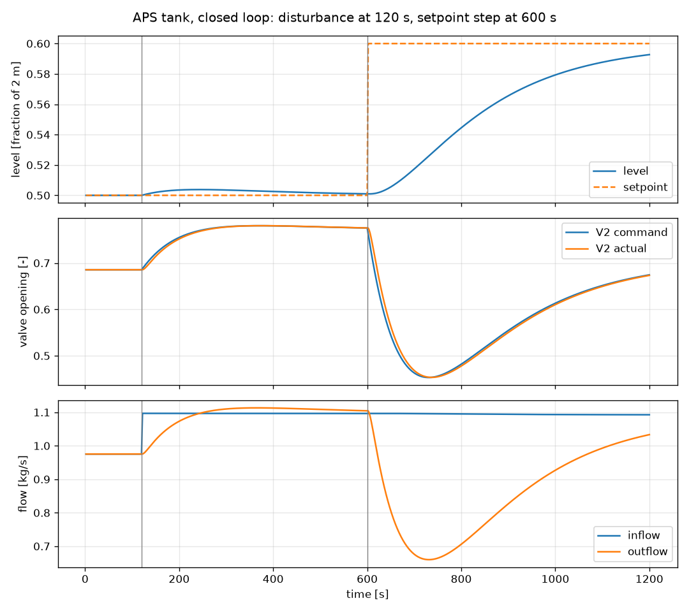
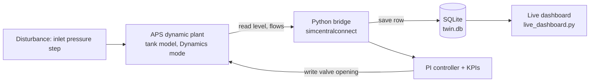
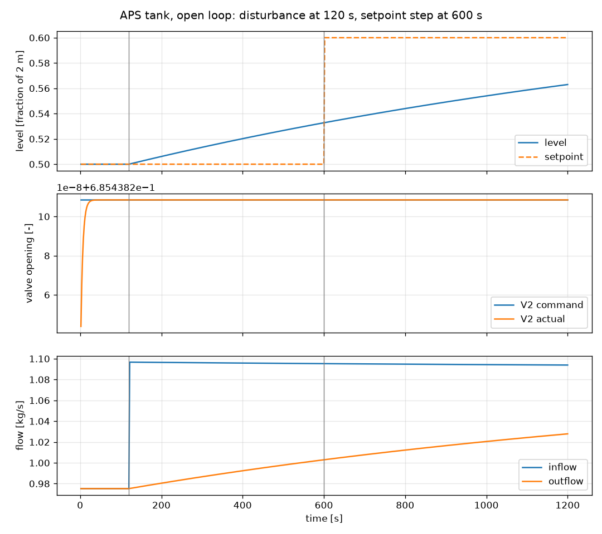

# APS + Python digital twin demonstrator

Closed-loop level control of an **AVEVA Process Simulation 2025** dynamic model, driven from **Python** through AVEVA's Scripting Interface, with a SQLite data store and a live dashboard.

> **Scope, stated honestly:** the "plant" is a dynamic APS model, not a physical rig. This project proves the software loop (read → store → decide → write back) that a digital twin needs. It is a *digital twin demonstrator using a simulated plant*.



## Architecture



Each loop step: `RunDynamics(sim, 2.0)` → read `Tank.Level` → PI decides → write `V2.ManPos` → log to SQLite. The dashboard only reads the database, so it cannot disturb the loop.

## Plant

`Source → V1 → Tank → V2 → Sink`, water at 298 K, tank D = 1 m, height 2 m, atmospheric, residence time ≈ 780 s. Python manipulates the outlet valve V2 (linear, 5 s first-order actuator lag).

## Results

Test: inlet pressure 300 → 350 kPa at t = 120 s (+12 % inflow), level setpoint 0.50 → 0.60 at t = 600 s. Steady start, 2 s control step, about 4.9× faster than real time.

| KPI | Open loop (valve fixed) | Closed loop (Python PI) |
|---|---|---|
| Max level error after disturbance | 6.5 cm | **0.8 cm** |
| IAE, disturbance window 120–600 s | 8.25 | **1.18 (−86 %)** |
| Stays within ±2 cm | No | **Yes** |
| Repeatability (two runs, same snapshot) | | **Identical KPIs** |



## Controller tuning (checked by hand)

The tank behaves as an integrating process. From the model's own values at the start:

- liquid per unit level fraction: ρ·A·H = 991 × 0.785 × 2 ≈ 1557 kg
- valve gain (linear valve): dF/du = F₀ / u₀ = 0.975 / 0.685 ≈ 1.42 kg/s
- integrator gain: k = 1.42 / 1557 ≈ 9.1 × 10⁻⁴ s⁻¹

SIMC rules for an integrating process with τc = 60 s and dead time θ = 6 s (valve lag 5 s + half the control step):

- Kc = 1 / (k (τc + θ)) ≈ 16.6
- τI = 4 (τc + θ) = 264 s

The PI runs in velocity form, with proportional action on the measurement, so a setpoint step does not slam the valve.

## What the Scripting Interface does (tested on APS 2025)

| Task | Call |
|---|---|
| Connect | `simcentralconnect.connect().Result` |
| Switch mode | `ISimulationManager.UpdateSimulationMode(sim, "Dynamics")` |
| Advance time | `RunDynamics(sim, dt, None)`: **blocks until done; dt is a duration** (tested) |
| Clock | `GetSimulationTimeDetails(sim)` returns a .NET object with `timeVariableValue` and `dtParameterValue` |
| Read / write | `IVariableManager.GetVariableValue` / `SetVariableValue`; internal units are SI (K, kPa, kg/s) |
| Reset / save state | `ISnapshotManager.RevertSnapshot` / `OverwriteSnapshot` |

## Lessons learned

1. **Process-mode pressures must match the Dynamics boundary conditions.** A tank sized at 110 kPa but set to atmospheric lost 27 % of its outflow at the switch and overflowed. `twin_loop.py init` now holds the level with Python, then saves a truly steady snapshot.
2. **Whole-run IAE misleads.** Report the disturbance and setpoint windows separately.
3. **P on error kicks the valve on setpoint steps.** P on measurement removes the kick but slows the setpoint response; setpoint weighting is the next step.

## Files

| File | Purpose |
|---|---|
| `twin_loop.py` | The loop: `init` (steady snapshot), `open` (baseline), `closed` (PI control) |
| `live_dashboard.py` | Live trends and KPIs from `twin.db` |
| `dyn_probe.py` | Tests how `RunDynamics` behaves |
| `list_vars.py` | Lists every variable and parameter of each model |
| `make_snapshot.py` | Lists, creates and renames snapshots |

## How to run

Needs a licensed APS install with its **Scripting Interface SDK** (not included; it is AVEVA's), and 64-bit Python 3.11.

```
pip install -r <SDK folder>\requirements.txt
python twin_loop.py init
python twin_loop.py open
python twin_loop.py closed
python live_dashboard.py        (in a second window)
```

## Next steps

- Setpoint weighting (2-degree-of-freedom PI) for a faster setpoint response
- Swap the tank for a PSA or anaerobic-digestion model, keeping the same loop
- Replace the PI rule with a model-based (predictive) decision layer

---
Mustafa Ali Yahya Adam: chemical engineering, BAİBÜ, Türkiye. AVEVA Process Simulation is a trademark of AVEVA Group Limited; this repository contains no AVEVA software or documentation.
